<!--
  SETUP:
  1. Create a PUBLIC repo named exactly: ASHTHRONE56-exe
  2. Upload this README.md AND case-file.svg to the repo root
  3. Edit the values inside case-file.svg (open it in any text editor)
-->

## `// TOOLS ON RECORD`

## `// ACTIVITY LOG`

## `// CONTACT`

FILE RP-ASH // RECORDS DIVISION // END OF REPORT

